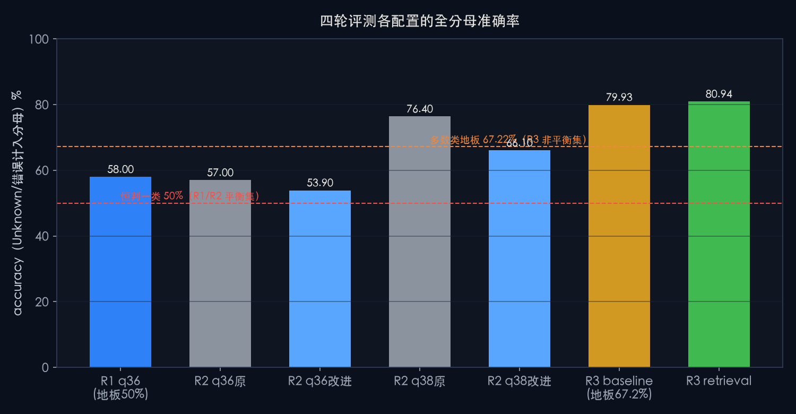
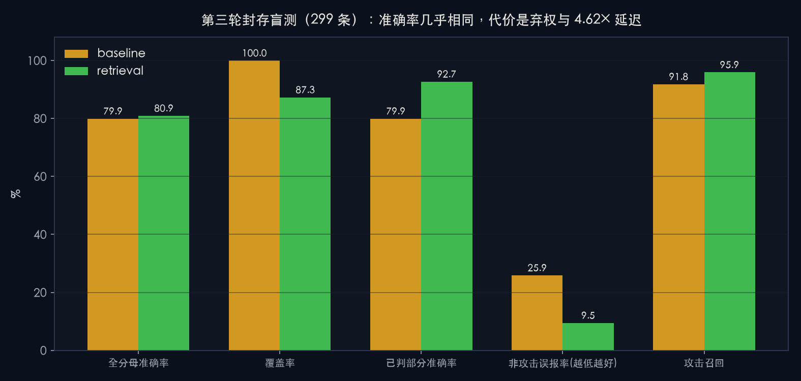
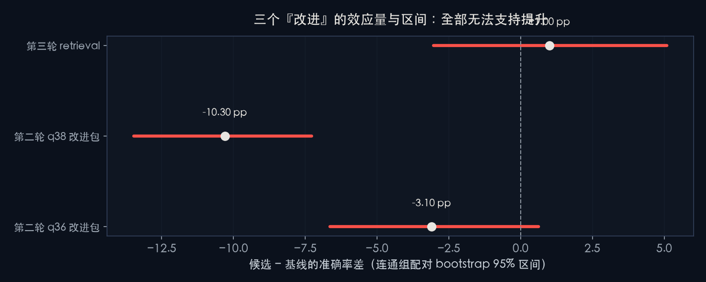
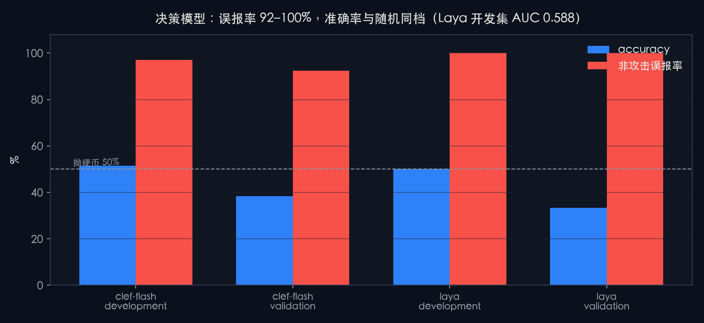

# 本地大模型做 SOC 告警二分类：四轮评测、盲测协议与四项负结果

> English (TL;DR): We ran four rounds of binary alert-triage evaluation (attack vs non-attack) with local
> LLMs on SecAlertBench, using group-isolated blind splits and pre-registered promotion gates.
> **None of the proposed improvements survived a sealed test set.** Best arm: 80.94% vs baseline 79.93%
> on 299 held-out cases, paired delta +1.00 pp, group-bootstrap 95% CI [-3.03, +5.10], exact McNemar
> p = 0.755 → not promoted. Two 421M/9.4B "typed decision" models degenerated to constant-"Attack"
> (FPR 100% / 97%). This repo publishes aggregate metrics only — no per-case data, no raw alerts,
> no infrastructure identifiers.

实验设备：NVIDIA DGX Spark（GB10，121 GB 统一内存），已于 2026-10-12 归还下线。
本仓库只收录该次实验的**聚合指标**与**方法学**，用于复现分析口径，不含逐条判定与原始告警。

## 1. 一句话结论

在同一个公开数据集上，用组隔离盲测协议连续评测四轮之后：**没有任何一条改进方向拿到统计上站得住的提升**。
最有价值的产出不是分数，而是三件方法学事实：盲测集之间的难度差异足以伪造 20 个百分点的"进步"、
弃权行为本身携带可复现的标签信息、以及盲测资源会在四轮内被耗尽。

## 2. 关键数字

| 轮次 | 配置 | n | 全分母准确率 | 覆盖率 | 攻击召回 | 非攻误报率 | 中位延迟 |
|---|---|---:|---:|---:|---:|---:|---:|
| 一 | q36 原始 | 400 | 58.00% | 99.75% | 85.50% | 69.00% | 1.58 s |
| 二 | q36 原始 | 1000 | 57.00% | 100% | 84.40% | 70.40% | 11.18 s |
| 二 | q36 改进包 | 1000 | 53.90% | 82.8% | 98.80% | 57.20% | 14.10 s |
| 二 | q38 原始 | 1000 | 76.40% | 99.9% | 96.40% | 43.60% | 43.72 s |
| 二 | q38 改进包 | 1000 | 66.10% | 81.0% | 99.60% | 29.80% | 56.26 s |
| 三（盲测） | q38--baseline | 299 | 79.93% | 100% | 91.84% | 25.87% | 28.10 s |
| 三（盲测） | q38--retrieval | 299 | 80.94% | 87.29% | 95.92% | 9.45% | 129.76 s |

对照基准：第一轮/第二轮是平衡样本，恒判一类 = 50%；第三轮盲测非攻击占 67.22%，恒判非攻击 = 67.22%。

| 决策模型 | 集合 | n | 准确率 | 非攻误报率 | TN | ECE |
|---|---|---:|---:|---:|---:|---:|
| Laya (421M) | development | 200 | 50.0% | 100.0% | 0 | 0.369 |
| Laya (421M) | validation | 120 | 33.3% | 100.0% | 0 | 0.545 |
| Clef-Flash (9.4B) | development | 200 | 51.5% | 97.0% | 3 | 0.394 |
| Clef-Flash (9.4B) | validation | 120 | 38.3% | 92.5% | 6 | 0.516 |

## 3. 图表






## 4. 四项负结果

1. **基线很弱**：58.00%（Wilson 95% [53.11, 62.74]）只比随机地板高 8 个百分点，且 100/138 条误报来自单一类别（SQL 注入）。
2. **改进包退化**：q36 −3.10 pp（CI [−6.64, +0.62]，McNemar p = 0.045）；q38 −10.30 pp（CI [−13.47, −7.27]，p = 1.8×10⁻¹⁶）。退化主因是弃权，而弃权几乎全落在非攻击上（169/172、188/190）。
3. **检索增强未晋级**：盲测 Δ +1.00 pp，CI [−3.03, +5.10]，配对精确 McNemar p = 0.755；九项预登记门槛中 `delta`、`ci_lower_positive`、`unknown_rate`、`normal_correct_rate` 四项未通过，`promoted = false`。它在验证集上曾领先 20 个百分点。
4. **决策模型不可用**：两个 typed decision 模型恒定输出"攻击"，独立复算 231 条原始响应全部判攻，P(攻) 最小 0.589、开发集 AUC 0.588、最优阈值仅 57.0%，`choice` 与 `argmax(prob)` 零不一致 → 不是解码缺陷。

另有两项中止：思考模式在 32 768 输出预算下仍不稳定，1 196 次调用一次未跑即取消；第四轮因盲测样本耗尽降级为回归。

## 5. 仓库结构

```
README.md              本文件
docs/PAPER.md          完整论文（方法与分析，含局限）
docs/PROTOCOL.md       盲测协议：组隔离、冻结、双口径、预登记门槛
docs/PROVENANCE.md     数据来源、哈希、脱敏记录、许可说明
results/               聚合指标 JSON（流水线导出 + 作者侧复算）
results/tables/        可直接用 Excel/pandas 打开的扁平表
figures/               四张图（由 results/ 生成）
```

## 6. 我们不发布什么，以及为什么

- **不发布逐条判定表**：上游 SecAlertBench 仓库的 license 字段为空（无许可证）。逐条复现其告警类别、规则名称等字段属于再分发原作者数据，因此本仓库只给聚合指标。
- **不发布原始告警载荷**：数据由三家企业脱敏而来，二次分发权不在我们手上。
- **不发布基础设施信息**：主机地址、路径、端口、服务名已从全部文档中移除；`results/` 内的 JSON 由我们自己导出，不含这些字段。

## 7. 复用方式

```python
import json, pandas as pd
r3 = json.load(open("results/round3.json"))
print(r3["promoted"], r3["delta_accuracy"], r3["bootstrap"]["ci95"], r3["gates"])
df = pd.read_csv("results/tables/headline_metrics.csv")
```

聚合口径：accuracy 的分母始终含 Unknown / 解析失败 / 截断 / 错误；覆盖率与已判部分准确率为辅助口径，两者不可互相替代。

## 8. 许可

本仓库自产的文字与数值表格采用 MIT 许可（见 `LICENSE`）。评测所用数据集的权利仍归原作者，
本仓库不构成对该数据集的任何再许可。
